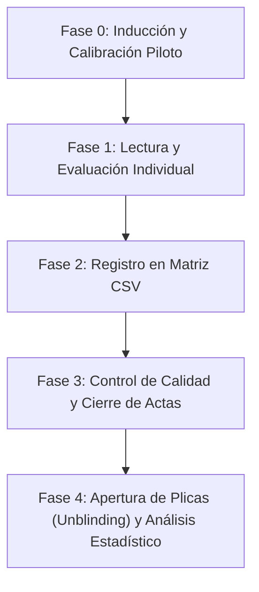

# PROTOCOLO Y METODOLOGÍA DE EVALUACIÓN CIEGA
## Evaluación Humana de Cuentos Educativos Generados por Inteligencia Artificial
**Tesis de Grado e Investigación Científica:** Prototipo Interactivo para la Comprensión Lectora Infantil  
**Entorno de Benchmark:** 60 cuentos pedagógicos generados por tres modelos de lenguaje

---

### 1. Justificación Epistemológica y Científica del Protocolo Ciego

En la literatura sobre evaluación de Modelos de Lenguaje de Gran Escala (LLM) aplicados a la educación, existe un riesgo comprobado de **sesgo de confirmación por marca o prestigio** (*brand bias*), donde los evaluadores tienden inconscientemente a otorgar puntuaciones más altas a modelos comercialmente reconocidos (p. ej., Google Gemini u OpenAI) frente a modelos abiertos o menos publicitados (como Qwen o GPT-OSS), o viceversa.

Para garantizar la **validez interna, neutralidad y reproducibilidad científica** de los resultados de esta tesis, la evaluación narrativa y pedagógica se conduce bajo un protocolo de **evaluación ciega controlada**:
1. **Anonimización absoluta de artefactos:** Los cuentos entregados a los evaluadores carecen de cualquier encabezado técnico, metadato de proveedor, latencia, recuento de tokens o mención de la arquitectura utilizada.
2. **Aleatorización distributiva:** El orden de presentación de los 60 cuentos se desordena completamente mediante un algoritmo pseudo-aleatorio determinista con semilla fija (`20261015`), evitando que los cuentos de un mismo modelo o caso se agrupen de forma consecutiva.
3. **Custodia criptográfica de la llave maestra:** La correspondencia entre el identificador ciego (`EVAL-01` a `EVAL-60`) y el modelo generador real (`gemini-3.5-flash-lite`, `qwen/qwen3.8-27b`, `openai/gpt-oss-20b`) permanece en el archivo confidencial [`llave_maestra_ciega.json`](file:///c:/Users/Ignacia/Documents/ChatGPT/tesis_investigacion/benchmark/evaluacion_pedagogica/llave_maestra_ciega.json), el cual no debe ser consultado por los jueces ni abierto por el investigador principal hasta haber completado y cerrado la recolección total de evaluaciones.

---

### 2. Estructura del Corpus de Cuentos (60 Historias)

El corpus está compuesto por **60 cuentos interactivos completos**, distribuidos simétricamente en un diseño experimental factorial balanceado:

$$\text{Total Cuentos} = 3 \text{ Modelos} \times 4 \text{ Casos Narrativos} \times 5 \text{ Repeticiones Experimentales} = 60 \text{ cuentos}$$

- **Modelos Evaluados (20 cuentos cada uno):**
  1. `gemini-3.5-flash-lite` (Google AI Studio)
  2. `qwen/qwen3.8-27b` (Groq Cloud)
  3. `openai/gpt-oss-20b` (Groq Cloud)
- **Casos de Estudio Temáticos (15 cuentos cada uno, 5 por modelo):**
  1. `caso_01_misterio_agua`: Misterio ecológico, observación de la naturaleza, empatía animal.
  2. `caso_02_robot_cielo`: Ciencia ficción infantil, inventiva tecnológica, superación del miedo a volar.
  3. `caso_03_arbol_hueco`: Aventura en el bosque, descubrimiento arqueológico/mágico, preservación del patrimonio.
  4. `caso_04_cometa_viento`: Trabajo colaborativo, resiliencia ante el fracaso, dinámica comunitaria.
- **Estructura Interna de Cada Cuento:**
  - 1 Análisis Estructural (planteamiento del protagonista, escenario y conflicto).
  - Escena 1 (Inicio) + 3 Opciones de ramificación.
  - Escena 2 (Desarrollo) + 3 Opciones de ramificación.
  - Escena 3 (Clímax) + 3 Opciones de ramificación.
  - Escena 4 (Desenlace reflexivo y cierre constructivo).

---

### 3. Selección y Perfil de los Evaluadores (Jueces Expertos)

Para otorgar solidez pedagógica y psicométrica a la investigación, se recomienda conformar un panel de **mínimo dos (2) y preferiblemente tres (3) evaluadores independientes**, con los siguientes perfiles de idoneidad:
1. **Docente de Educación Primaria en ejercicio:** Con experiencia directa en 3.ᵉʳ o 4.º grado (enseñanza de comprensión lectora, currículo escolar y vocabulario infantil).
2. **Psicopedagogo/a o Especialista en Dificultades de Aprendizaje:** Con formación en mediación lectora, habilidades socioemocionales y diseño de estímulos cognitivos.
3. **Especialista en Lingüística Aplicada o Literatura Infantil y Juvenil:** Con capacidad para valorar la coherencia dramatúrgica, riqueza estética y recursos estilísticos.

#### Criterios de Exclusión:
- No haber participado en el desarrollo técnico del software, codificación de prompts ni ejecución de las pruebas API del benchmark.
- Declarar ausencia de conflicto de interés comercial con los proveedores de los modelos evaluados.

---

### 4. Guía Operativa Paso a Paso para la Evaluación

El proceso de evaluación se ejecuta en cuatro fases secuenciales:

#### Fase 0: Inducción y Calibración Previa (30 minutos)
1. El investigador entrega a los evaluadores la [Rúbrica de Evaluación Pedagógica](file:///c:/Users/Ignacia/Documents/ChatGPT/tesis_investigacion/benchmark/evaluacion_pedagogica/rubrica_evaluacion_pedagogica.md) y la [Guía Rápida del Evaluador](file:///c:/Users/Ignacia/Documents/ChatGPT/tesis_investigacion/benchmark/evaluacion_pedagogica/guia_rapida_evaluador.md).
2. Se realiza una lectura conjunta de 2 cuentos piloto externos (no incluidos en los 60 del corpus oficial).
3. Cada evaluador califica los cuentos piloto de forma independiente y se contrasta la puntuación. Si existen discrepancias superiores a 1 punto en algún criterio, se analizan los descriptores hasta alinear criterios de exigencia.

#### Fase 1: Lectura y Calificación Individual de los 60 Cuentos
1. Cada evaluador accede a la carpeta [`benchmark/evaluacion_pedagogica/cuentos_ciegos/`](file:///c:/Users/Ignacia/Documents/ChatGPT/tesis_investigacion/benchmark/evaluacion_pedagogica/cuentos_ciegos/).
2. Abre el cuento correspondiente siguiendo el orden secuencial de su identificador ciego (`EVAL-01.md` hasta `EVAL-60.md`).
3. Lee el relato completo de principio a fin, prestando atención a las 4 escenas y a las opciones de ramificación.
4. Completa la [Ficha de Evaluación Individual](file:///c:/Users/Ignacia/Documents/ChatGPT/tesis_investigacion/benchmark/evaluacion_pedagogica/ficha_evaluacion_individual.md) o ingresa directamente los puntajes en su matriz asignada.
5. Tiempo estimado por cuento: **4 a 6 minutos**. Se sugiere distribuir la evaluación en 3 a 4 sesiones de 15 a 20 cuentos para prevenir la fatiga cognitiva del evaluador.

#### Fase 2: Registro en la Matriz de Evaluación
1. Cada evaluador completa su copia de la matriz [`matriz_evaluacion_ciega.csv`](file:///c:/Users/Ignacia/Documents/ChatGPT/tesis_investigacion/benchmark/evaluacion_pedagogica/matriz_evaluacion_ciega.csv), ingresando:
   - `id_evaluador` (código único del juez, ej. `JUEZ_01`)
   - `fecha_evaluacion` (`YYYY-MM-DD`)
   - Puntuación entera o con medios puntos de 1 a 5 para:
     - `criterio_1_coherencia_25pct`
     - `criterio_2_vocabulario_20pct`
     - `criterio_3_continuidad_20pct`
     - `criterio_4_decisiones_15pct`
     - `criterio_5_potencial_educativo_20pct`
   - `puntuacion_ponderada_preliminar` (fórmula automática)
   - `observaciones_cualitativas` (comentarios y justificaciones breves)

#### Fase 3: Control de Calidad y Cierre de Actas
1. El investigador verifica que los 60 registros estén completos (sin celdas vacías en las puntuaciones).
2. Se confirma formalmente que los evaluadores concluyeron su labor antes de revelar cualquier información del modelo.
3. Se firman las actas o registros de conformidad.

#### Fase 4: Apertura de Plicas (*Unblinding*) y Consolidación
1. Se ejecuta el script de consolidación que cruza `matriz_evaluacion_ciega.csv` con [`llave_maestra_ciega.json`](file:///c:/Users/Ignacia/Documents/ChatGPT/tesis_investigacion/benchmark/evaluacion_pedagogica/llave_maestra_ciega.json).
2. Se genera la [`matriz_evaluacion_maestra.csv`](file:///c:/Users/Ignacia/Documents/ChatGPT/tesis_investigacion/benchmark/evaluacion_pedagogica/matriz_evaluacion_maestra.csv) con las puntuaciones asociadas a cada modelo (`Gemini 3.5 Flash Lite`, `Qwen 3.8 27B`, `GPT-OSS 20B`).

---

### 5. Metodología de Análisis Estadístico Posterior

Una vez recolectadas las evaluaciones humanas, los datos se someterán al siguiente tratamiento estadístico formal para la redacción de la tesis:

#### 1. Análisis de Confiabilidad Inter-Jueces
Para demostrar el rigor del instrumento y el grado de acuerdo entre evaluadores independientes:
- **Coeficiente de Correlación Intraclase (ICC):** Modelo de dos vías de efectos aleatorios con acuerdo absoluto, $\text{ICC}(2, 1)$ para jueces individuales e $\text{ICC}(2, k)$ para la media de jueces. Se espera $\text{ICC} \ge 0.75$ (buena a excelente fiabilidad).
- **Alfa de Krippendorff ($\alpha$):** Aplicado a variables ordinales/escalares para confirmar la reproducibilidad de la rúbrica ($\alpha \ge 0.80$).

#### 2. Estadística Descriptiva por Modelo y Criterio
- Para cada uno de los tres modelos y para cada criterio se reportarán:
  - Media ($\bar{X}$) y Desviación Estándar ($SD$).
  - Mediana ($Mdn$) y Rango Intercuartílico ($IQR$).
  - Puntuación ponderada global media sobre 5.00 puntos y sobre 100 puntos.

#### 3. Pruebas de Hipótesis Inferenciales
- **Prueba de Normalidad:** Shapiro-Wilk sobre las distribuciones de puntuación por modelo.
- **Contraste de Medias / Medianas:**
  - Si se cumple normalidad: **ANOVA de un factor** para muestras independientes o medidas repetidas con corrección de Greenhouse-Geisser.
  - Si no se cumple normalidad: **Prueba no paramétrica de Kruskal-Wallis** ($H$).
- **Análisis Post-Hoc:** Pruebas de Tukey HSD (paramétrica) o pruebas de Dunn-Bonferroni (no paramétrica) con ajuste de tasa de falso descubrimiento para identificar qué parejas de modelos presentan diferencias estadísticamente significativas ($p < 0.05$).
- **Tamaño del Efecto:** Eta cuadrado ($\eta^2$) o d de Cohen para cuantificar la magnitud de las diferencias encontradas.

---

### 6. Cronograma Estimado de Ejecución

| Hito / Actividad | Duración Estimada | Responsable |
| :--- | :---: | :--- |
| **H1:** Revisión y aprobación de la rúbrica y catálogo | 1 día | Tesista / Asesor de Tesis |
| **H2:** Reclutamiento y sesión de calibración de jueces | 2 días | Investigador / Jueces |
| **H3:** Ronda de evaluación ciega de los 60 cuentos | 4 a 6 días | Panel de Jueces |
| **H4:** Consolidación, apertura de plicas y cruce de datos | 1 día | Investigador |
| **H5:** Procesamiento estadístico (ICC, ANOVA/Kruskal-Wallis) | 1 día | Investigador |
| **H6:** Redacción del capítulo de resultados de la tesis | 3 días | Tesista |
